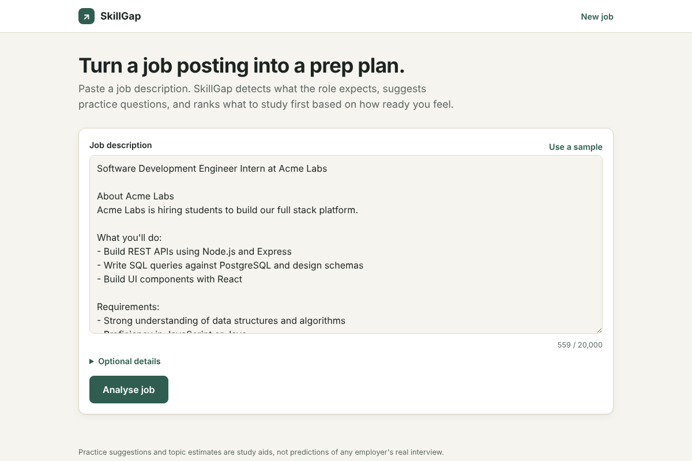
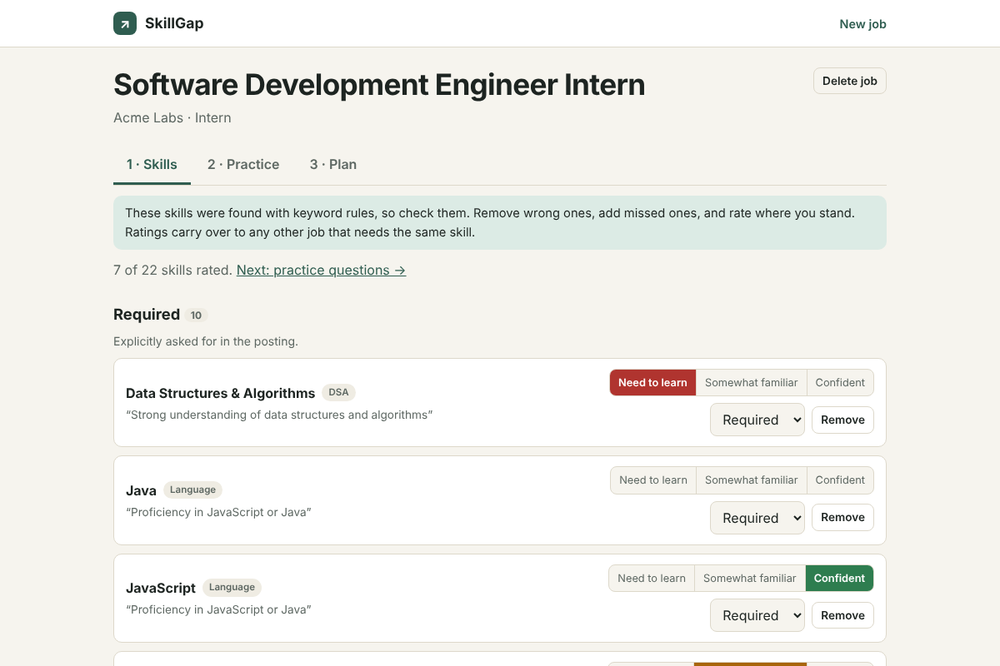
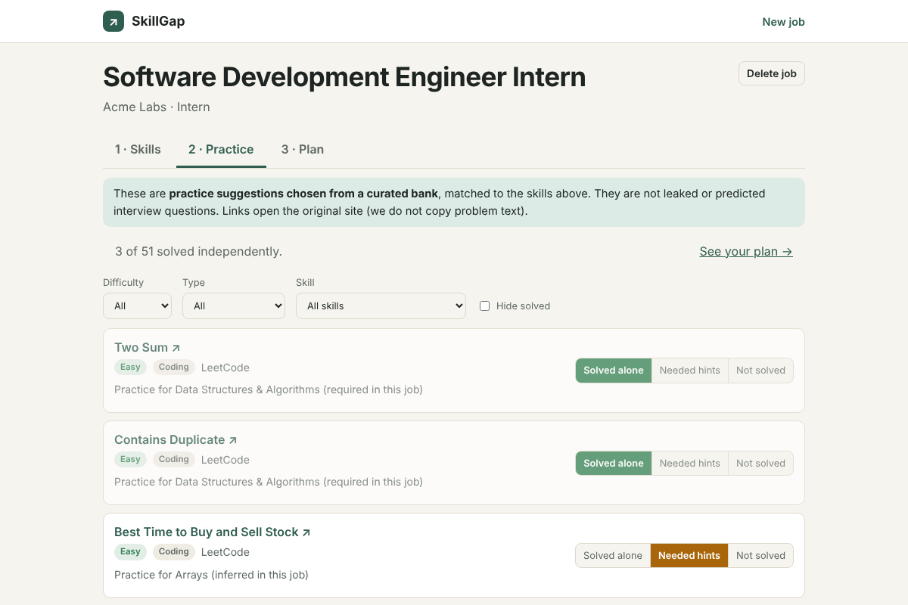
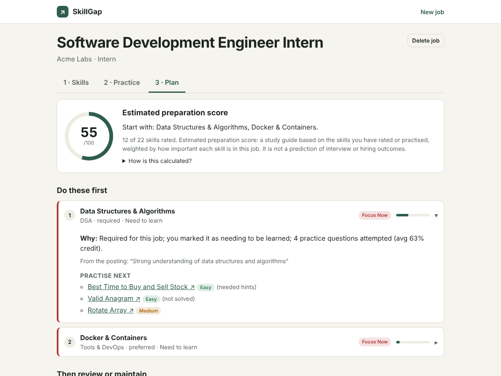

# SkillGap

**Turn a real job posting into a practical, personalised interview-prep plan.**

🔗 **Live demo: [skillgap-gamma.vercel.app](https://skillgap-gamma.vercel.app)**

> ⏳ **Heads-up:** the demo runs on free hosting tiers. If nobody has used it for a while, the API and database go to sleep, so the **first request can take up to a minute**. After that it is fast.

Paste a job description. SkillGap detects the skills the role asks for (showing the exact phrase behind each one), suggests practice questions from a curated bank, lets you rate your own level, and produces a ranked study plan with a short reason for every recommendation.

> **Honest by design.** Skill detection is rule-based and fully transparent. Questions are *practice suggestions*, not predictions of any employer's interview. The "estimated preparation score" is a study guide, not a hiring prediction, and the UI says so.

## Screenshots

| 1. Paste a job description | 2. Review detected skills and rate yourself |
|---|---|
|  |  |
| **3. Practise curated questions** | **4. Get a ranked, explained plan** |
|  |  |

## Features
- **Transparent skill extraction** across a 53-skill taxonomy (DSA, languages, web, SQL/DBMS, CS fundamentals, tools). Each skill is marked *required*, *preferred* or *inferred* and links back to the line it came from. Wrong or missing skills can be fixed by hand.
- **Curated question bank** of 160+ items (LeetCode, Codeforces, official docs) matched to skills by tags, with a mixed difficulty spread. Only links are stored; no problem text is copied.
- **Self-assessment**: rate each skill (*need to learn / somewhat familiar / confident*) and mark each question (*solved alone / needed hints / not solved*).
- **Explainable prioritisation**: importance in the job × your confidence × your practice results, with a plain-language reason per topic.
- **Persistence**: ratings, edits and progress are saved in PostgreSQL and survive a refresh.
- Input validation, rate limiting and graceful error states throughout.

## Tech stack
React + Vite + React Router (plain CSS) · Node.js + Express · PostgreSQL (`pg`, parameterised queries only) · hosted on Vercel (frontend), Render (API) and Neon (database).

## Architecture
```
Browser (React, Vercel)
   │  HTTPS / JSON
   ▼
Express API (Render)
   ├─ services/analyzer.js     rule-based skill + metadata extraction   (pure, unit-tested)
   ├─ services/recommender.js  curated question selection               (pure, unit-tested)
   ├─ services/plan.js         explainable priority formula             (pure, unit-tested)
   └─ PostgreSQL (Neon)        jobs, skills, questions, assessments, progress
```
**Identity:** the browser generates a random key (`X-User-Key`). There are no accounts or passwords in this version; data is scoped to that key and one visitor cannot read another's jobs.

## Run locally
Requires Node 20+ and PostgreSQL 14+.

```bash
# 1. database
createdb skillgap            # or use any Postgres and set DATABASE_URL

# 2. backend
cd server
cp .env.example .env         # edit DATABASE_URL if needed
npm install
npm run seed                 # creates tables, loads skills and the question bank
npm start                    # http://localhost:4000

# 3. frontend (new terminal)
cd client
npm install
npm run dev                  # http://localhost:5173  (proxies /api to :4000)
```

Tests: `cd server && npm test` (25 tests; the API tests need the seeded database).
Verify the question links (needs open internet): `npm run check-links`.

## API
| Method & path | Purpose |
|---|---|
| `POST /api/jobs/analyze` | Analyse pasted text, save the job, return skills + suggested questions |
| `GET /api/jobs`, `GET /api/jobs/:id`, `DELETE /api/jobs/:id` | List / load / delete saved jobs |
| `POST /api/jobs/:id/skills`, `PATCH` / `DELETE /api/jobs/:id/skills/:skillId` | Correct detected skills (questions are re-selected) |
| `GET /api/questions?skill=React&difficulty=easy&type=concept` | Browse the curated bank |
| `GET /api/skills` | Skill taxonomy |
| `POST /api/assessments/skills` | Save `confident` / `somewhat_familiar` / `need_to_learn` |
| `POST /api/progress/questions` | Save `solved_independently` / `needed_hints` / `not_solved` (`status: null` clears) |
| `GET /api/jobs/:id/plan` | Ranked preparation plan |
| `GET /api/health` | Health check (also tests the database connection) |

## How the plan is computed
Per skill: `readiness = (1 − w) · self_rating + w · practice`
- `self_rating`: confident 0.9 · somewhat familiar 0.5 · need to learn 0.1 · not rated 0.5 (unknown).
- `practice`: mean credit over attempted questions (solved alone 1 · hints 0.5 · not solved 0).
- `w = min(attempts, 3) / 3 × 0.5`, so practice can account for up to half of readiness.

`priority = importance_weight × (1 − readiness)` with required 3, preferred 2, inferred 1. The score is the importance-weighted mean readiness of the skills you have rated or practised; unrated skills are listed separately rather than assumed weak. Constants live at the top of `server/src/services/plan.js`.

## Database schema
`skills`, `questions`, `question_skills` (tags), `jobs`, `job_skills` (importance + evidence), `job_questions` (relevance reason), `user_skill_assessments`, `user_question_progress`. See `server/src/db/schema.sql`.

## Deployment
| Part | Host | Settings |
|---|---|---|
| Frontend | Vercel | Root directory `client`, env `VITE_API_URL=<API address>` |
| API | Render | Root directory `server`, build `npm install`, start `npm start`, env `DATABASE_URL`, `DATABASE_SSL=true`, `TRUST_PROXY=1`, `CLIENT_ORIGIN=<frontend address>` |
| Database | Neon | Run `npm run seed` once with `DATABASE_URL` pointing at it |

`client/vercel.json` rewrites all routes to `index.html` so refreshing a deep link works. Secrets live only in the hosts' environment settings; see `server/.env.example`.

## Limitations
- Keyword rules miss implicit or unusual wording (for example "build things that scale"), which is why users can edit skills.
- The question bank is small and tuned for software roles. Run `npm run check-links` to verify links before relying on them.
- No accounts yet; clearing browser storage loses access to your saved data.
- Job URLs are stored but never fetched, because job sites restrict scraping.
- Free hosting means cold starts and usage limits.

## Security notes
Parameterised SQL only · server-side validation and length limits on every route · JSON body limit · rate limiting · CORS restricted to the deployed frontend · secrets only in environment variables · no keys in the frontend.

## Roadmap
- AI-assisted parsing: an LLM extracts structured data on the backend, its output is validated, and the rule engine stays as the fallback.
- A "Send to SkillGap" bookmarklet and job-board API import (Greenhouse / Lever) instead of scraping.
- Accounts and multi-job comparison.
